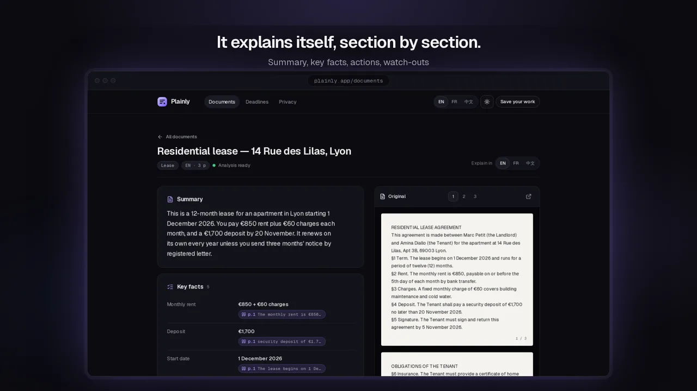
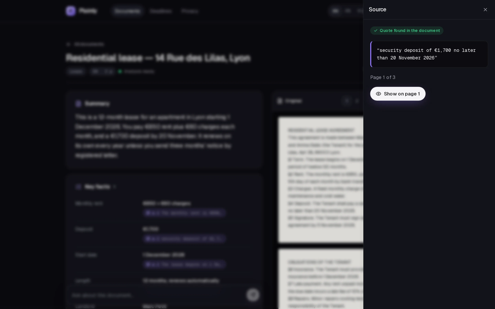
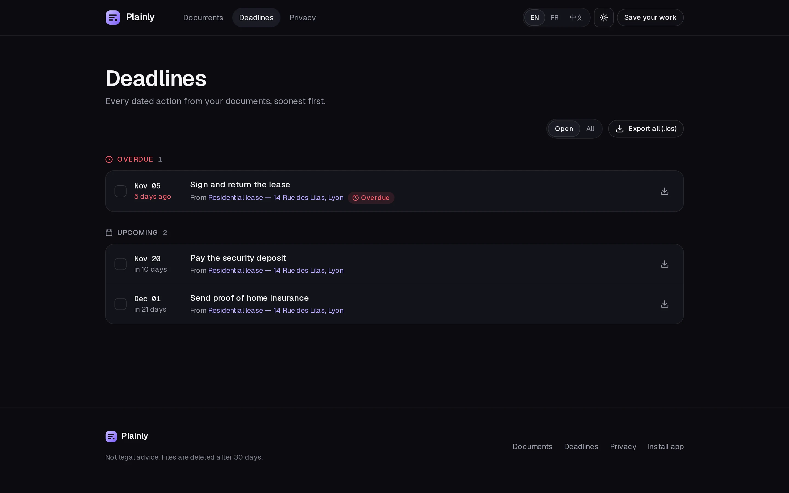
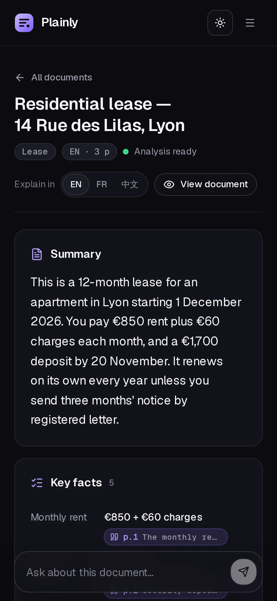
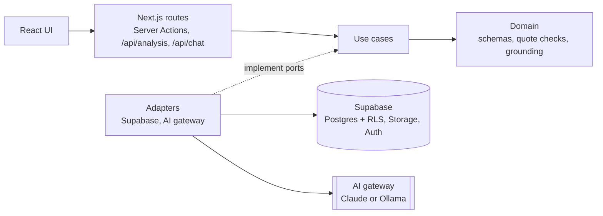

<div align="center">

# Plainly

**Paperwork, in plain language.**

Drop in a lease, a visa letter, a job offer or a contract. Plainly explains what it says, lists what you have to do and by when, and answers your questions from the document itself. Every point links to the sentence it came from.


[Quick start](#quick-start) · [AI modes](#ai-modes) · [Commands](#commands) · [Documentation](#documentation) · [Troubleshooting](#troubleshooting)

[](apps/web/public/videos/showreel.mp4)

</div>

## Screenshots

| Analysis | Source check |
|---|---|
|  |  |
| **Chat** | **Deadlines** |
|  |  |

<p align="center">
  
  
  
</p>

## Features

- **Plain-language analysis.** Summary, key facts, what you must do and by when, ranked watch-outs and a glossary, streamed section by section.
- **Every claim has a source.** Each quote is checked against the document text. Claims whose quote can't be found are removed, and "Show on page" highlights the sentence.
- **Deadlines that don't get invented.** A date is kept only if its quote shows it. Relative rules ("within 30 days of arrival") and ambiguous dates (03/04/2027) ask you to pick the date.
- **Chat with the document.** Answers come only from the document, with quotes. If there's no quote, Plainly says so instead of guessing.
- **Many formats.** PDF, Word, Excel, PowerPoint, images and text. Scans need a vision-capable model.
- **Three languages.** English, French and Chinese interface, and explanations in any of the three, whatever the document's language.
- **Any AI provider.** Claude, or Ollama on your own machine or in the cloud, switched with one line of config.

> Plainly explains documents. It is not legal advice.

## Quick start

### Prerequisites

| Tool | Version | macOS | Windows | Linux |
|---|---|---|---|---|
| [Node.js](https://nodejs.org) | 20.19 or newer | `brew install node` | `winget install OpenJS.NodeJS.LTS` | [fnm](https://github.com/Schniz/fnm) or your package manager |
| pnpm | 10 | `corepack enable` | `corepack enable` | `corepack enable` |
| [Docker](https://docs.docker.com/get-docker/) | any recent | Docker Desktop | Docker Desktop (WSL 2) | Docker Engine |
| [Supabase CLI](https://supabase.com/docs/guides/local-development/cli/getting-started) | 2.x | `brew install supabase/tap/supabase` | `scoop bucket add supabase https://github.com/supabase/scoop-bucket.git` then `scoop install supabase` | `brew install supabase/tap/supabase`, or the `.deb`/`.rpm` from the releases page |
| [Ollama](docs/OLLAMA.md) (optional) | any recent | `brew install ollama` | `winget install Ollama.Ollama` | `curl -fsSL https://ollama.com/install.sh \| sh` |

Docker must be running before `supabase start`.

### 1. Install

```bash
git clone <your-repo-url> plainly
cd plainly
corepack enable
pnpm install
```

### 2. Start the local database

```bash
supabase start      # Postgres, Auth, Storage and Studio in Docker; applies the migrations
supabase status     # prints the URLs and keys you need next
```

| Service | URL |
|---|---|
| API | http://127.0.0.1:54325 |
| Studio (database UI) | http://127.0.0.1:54327 |

### 3. Configure

Copy the example env file:

```bash
# macOS / Linux
cp apps/web/.env.example apps/web/.env.local
```

```powershell
# Windows (PowerShell)
Copy-Item apps/web/.env.example apps/web/.env.local
```

Then fill in `apps/web/.env.local` from `supabase status`:

| Variable | Value from `supabase status` |
|---|---|
| `NEXT_PUBLIC_SUPABASE_URL` | API URL (`http://127.0.0.1:54325`) |
| `NEXT_PUBLIC_SUPABASE_PUBLISHABLE_KEY` | Publishable key (`sb_publishable_…`) |
| `SUPABASE_SECRET_KEY` | Secret key (`sb_secret_…`) |

Choose an [AI mode](#ai-modes). The default, `USE_FAKE_AI=true`, works offline with no key.

### 4. Run

```bash
pnpm dev            # http://localhost:3000
```

### 5. Sign in with a test account

```bash
pnpm test-user create     # creates a local account; its email and password go to apps/web/.env.test-user
pnpm test-user approve    # approves it, like entering the emailed code
pnpm test-user status     # shows the email, approval, plan and credits
```

`apps/web/.env.test-user` is ignored by git. More in [Accounts](docs/AUTH.md#7-local-test-user).

## AI modes

Set in `apps/web/.env.local`, then restart `pnpm dev`.

| Mode | When | Settings |
|---|---|---|
| **Fake** (default) | UI work, tests, demos. Offline, free, instant | `USE_FAKE_AI=true` |
| **Ollama** | Real analysis with no API key, on your machine or Ollama Cloud. → [Ollama guide](docs/OLLAMA.md) | `USE_FAKE_AI=false`<br>`AI_MODEL=ollama:llama3.2:3b`<br>`AI_TIMEOUT_MS=600000` |
| **Claude** | Best quality, production. → [AI providers](docs/AI_PROVIDERS.md) | `USE_FAKE_AI=false`<br>`ANTHROPIC_API_KEY=…`<br>`AI_MODEL=anthropic:claude-sonnet-5-5` |

`AI_MODEL` sets one model for everything. To tune each task (analysis, chat, translation) or add fallbacks, use the `AI_PROFILE_*` lines described in [AI providers](docs/AI_PROVIDERS.md#3-configuration).

## Commands

Run from the repository root.

| Command | What it does |
|---|---|
| `pnpm dev` | Start the app at http://localhost:3000 |
| `pnpm build` / `pnpm start` | Production build, then serve it |
| `pnpm check` | Everything CI runs: Biome, TypeScript, unit tests, dependency rules |
| `pnpm lint` / `pnpm format` | Biome check / fix |
| `pnpm test` | Unit and use-case tests (Vitest) |
| `pnpm e2e` | End-to-end tests (Playwright, fake AI) |
| `pnpm db:test` | Database tests: RLS isolation and credits (pgTAP) |
| `pnpm db:types` | Regenerate database types after a migration |
| `pnpm ai:try --model <provider:model> --file <file>` | One analysis with one model: schema, quotes, tokens, time |
| `pnpm ai:eval --model <provider:model>` | The eval set; tells you if a model is good enough for production |
| `pnpm test-user create \| approve \| reset \| status` | Manage the local test account |
| `supabase start` / `supabase stop` | Start / stop the local database |
| `supabase db reset` | Rebuild the local database from the migrations (deletes local data) |

## Project structure

```
plainly/
├─ apps/web/                 Next.js app
│  ├─ src/app/               Routes only (pages, Server Actions, API routes)
│  ├─ src/modules/           Features: documents, analysis, chat, deadlines, ai, billing, accounts
│  │                         each with domain ← application ← infrastructure / ui
│  ├─ src/server/            Composition root: wires adapters to use cases
│  ├─ src/shared/            Config (env), UI kit, i18n, helpers
│  ├─ messages/              UI copy: en.json, fr.json, zh.json
│  ├─ evals/ · samples/      Eval documents and the built-in samples
│  └─ scripts/               ai:try, ai:eval, test-user
├─ supabase/                 Migrations, config, database tests
├─ docs/                     Guides and decisions (see below)
└─ assets/                   Mockup, screenshots and video sources
```

## Architecture

A modular monolith with ports and adapters inside each module. CI enforces the dependency rule.



What happens to one document:

```
upload → check type, size, pages → private storage → extract page text
       → AI writes a structured analysis, streamed to the screen
       → every quote checked against the page text → claims without a real quote dropped → saved
```

Read [Architecture](docs/ARCHITECTURE.md) for the full picture and [Decisions](docs/DECISIONS.md) for the trade-offs.

## Documentation

| Guide | What's inside |
|---|---|
| [Ollama](docs/OLLAMA.md) | Install, start, check and pick local models; Windows, macOS, Linux |
| [AI providers](docs/AI_PROVIDERS.md) | Profiles, fallbacks, adding a provider, promoting a model |
| [Token economy](docs/TOKEN_ECONOMY.md) | How AI cost is kept low, budgets, usage records |
| [Architecture](docs/ARCHITECTURE.md) | Layers, modules, folder structure |
| [Accounts](docs/AUTH.md) | Sign-in methods, approval, the local test user |
| [Pricing](docs/PRICING.md) | Plans, credits, what each action costs |
| [Security](docs/SECURITY.md) | Controls and how each one was verified |
| [Compliance](docs/COMPLIANCE.md) | Data processors, retention, user rights |
| [Deploy](docs/DEPLOY.md) | Vercel and Supabase production setup, launch checklist |
| [Runbook](docs/RUNBOOK.md) | Incidents, feature flags, where to look first |
| [Design](docs/DESIGN.md) | Visual language, motion, accessibility rules |
| [Decisions](docs/DECISIONS.md) | Architecture decision records |
| [Product brief](PRD.md) | Scope, users, non-goals |

## Troubleshooting

| Problem | Fix |
|---|---|
| `supabase start` fails with a Docker error | Start Docker Desktop (macOS/Windows) or `sudo systemctl start docker` (Linux), then retry |
| A port is already in use (54325, 54326, 54327…) | Another Supabase project is running: `supabase stop --project-id <other>`, or stop the program using the port |
| `Invalid server env: …` when the app starts | The message names the variable. Compare `apps/web/.env.local` with `.env.example` |
| TypeScript errors about database types after pulling | `supabase db reset && pnpm db:types` |
| Analysis says "The AI service is unavailable" | With Ollama: run the checks in the [Ollama guide](docs/OLLAMA.md#3-check-its-running). With Claude: check `ANTHROPIC_API_KEY` |
| Can't sign in locally | `pnpm test-user status`, then `pnpm test-user create` and `approve` |
| Page looks stale after switching branches | Stop `pnpm dev`, delete `apps/web/.next`, start again |
