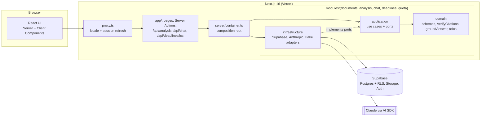

# Plainly

**Paperwork, in plain language.** Drop in a lease, a visa letter, a job offer or a contract. Plainly explains what it says, lists what you have to do and by when, and answers your questions, all from the document itself. Every point links to the sentence it came from.

[](public/videos/showreel.mp4)

- English, French and Chinese interface, and explanations in any of the three, whatever the document's language.
- No signup: guests can analyse right away and keep their work by signing in later.
- Not legal advice. Plainly explains; you decide.

## How it works

1. **Upload** a PDF, a photo or pasted text (10 MB, 20 pages), or try one of three samples.
2. **Read** a streamed summary, key facts, dated actions, ranked watch-outs and a glossary.
3. **Check** any point: its quote is verified against the document text, and the source page is highlighted.
4. **Act**: deadlines are collected on one page and export to your calendar as `.ics`.
5. **Ask** questions. Answers come only from the document, with quotes, or Plainly says "I can't find that in this document."

## Architecture

A modular monolith with ports and adapters inside each module. The dependency rule is enforced in CI by dependency-cruiser.



```
domain  <-  application  <-  infrastructure / ui / app
```

| Layer | Lines | What lives there |
|---|---:|---|
| domain | 508 | Zod schemas, quote verification, grounding rule, deadlines, `.ics` |
| application | 561 | use cases (`analyzeDocument`, `answerQuestion`, …) and ports |
| infrastructure | 1,158 | Supabase repositories, file store, Anthropic and Fake adapters |
| ui (modules) | 1,756 | drop zone, analysis view, citation sheet, chat, deadlines |
| app + server | 1,115 | routes, Server Actions, composition root, auth |
| tests | 1,074 | unit, use case, eval and e2e (plus 305 lines of SQL and pgTAP) |

The pipeline for one document:

```
upload → validate type/size/pages → private bucket → extract page text (unpdf)
       → Claude reads the original file → structured output (Zod) streamed to the UI
       → every quote checked against the page text → unverified claims dropped → saved
```

Decisions and trade-offs are in [`docs/DECISIONS.md`](docs/DECISIONS.md). Security controls, each with how it was verified, are in [`docs/SECURITY.md`](docs/SECURITY.md).

## Stack

Next.js 16 (App Router, Turbopack, Cache Components, `proxy.ts`) · React 19 · TypeScript strict · Tailwind CSS v4 · shadcn/ui · Supabase (Postgres, Auth, Storage, RLS) · Vercel AI SDK 7 + Claude (`claude-sonnet-5-5`, `claude-haiku-5-5`) · Zod 4 · next-intl · unpdf · React Bits · Biome · Vitest · Playwright · dependency-cruiser · pnpm.

## Run it locally

Requirements: Node 20.19+, pnpm 10, Docker and the Supabase CLI.

```bash
pnpm install
supabase start                 # local Postgres, Auth and Storage
supabase migration up          # schema, RLS, quota functions
cp .env.example .env.local     # then fill in the keys from `supabase status`
pnpm dev                       # http://localhost:3000
```

With `USE_FAKE_AI=true` (the default in `.env.example`) everything works offline and for free with a deterministic analyzer. Set `ANTHROPIC_API_KEY` and `USE_FAKE_AI=false` to use Claude.

## Test it

```bash
pnpm check      # Biome, TypeScript, Vitest (66 tests), dependency rule
pnpm db:test    # pgTAP: RLS isolation and quota (24 assertions)
pnpm e2e        # Playwright, desktop + mobile, fake AI (19 tests)
pnpm eval       # 10 documents: deadline recall, fact recall, quote verification
```

## Evals

`evals/` holds 10 documents (leases, visa and work-permit letters, an offer, bank, tax, insurance and phone notices) in English, French and Chinese, with the deadlines and facts each one should yield. `pnpm eval` reports deadline recall, fact recall, the share of claims whose quotes pass verification, and any dates the model added that the document doesn't state.

| Run | Deadline recall | Fact recall | Quotes verified | Unexpected dates |
|---|---:|---:|---:|---:|
| Fake analyzer (baseline, knows only the 3 samples) | 37.5% | 87% | 98% | 0 |
| `claude-sonnet-5-5` (`EVAL_LIVE=1`) | _run with an API key_ | | | |

## Quality

Lighthouse on a production build (mobile, simulated throttling): accessibility 100 and best practices 100 on every page, performance 93 to 96, observed LCP about 0.5 s. Desktop performance 100.

## Media

Screenshots and videos are built from the running app, so they always match the product.

- `node media/capture.ts` captures every screen at desktop and mobile size, in dark and light (`media/SHOTS.md` lists each shot and where it is used).
- `media/videos/` holds one HTML file per video. `media/render-all.sh` renders them to `public/videos/` and the social cuts to `media/out/`. `media/videos/PROMPTS.md` has the prompt and beat map behind each one.
- Plainly installs as a web app on desktop and mobile (see ADR 6).

## Project kit

`CLAUDE.md`, `PRD.md` and `docs/` are the brief this project was built from. `mockup/index.html` is the clickable HTML mockup made before implementation.
